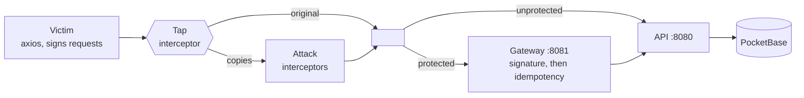

# orderguard

**English** · [Português](README.pt-BR.md)

One click should mean one order, even with a man in the middle.

This project reproduces a man-in-the-middle attack that duplicates, replays and tampers with order requests, then stops it with a Go gateway. The attacker is written as axios interceptors, and the demo counts the orders that really reached the database:

| | orders created from 1 click |
|---|---|
| Direct to the API | **14**, one of them with quantity × 100 |
| Through the gateway | **1** |

> **Status:** the API, gateway and attacker work today. The Next.js frontend and load test are still to come, so expect this page to change.

## Quick start

You need [Go](https://go.dev/dl/) 1.24+ and [Node.js](https://nodejs.org/) 20+. The same commands work in Git Bash, PowerShell, cmd and sh.

```sh
git clone https://github.com/raulbattistini3-sys/order-api-with-mim-fixed.git
cd order-api-with-mim-fixed
node scripts/run.mjs
```

That one command starts everything, runs the attacks, prints the results and stops. It exits with `0` only if the gateway let exactly one order through. The first run needs internet access: it downloads the PocketBase version pinned in `pocketbase/Dockerfile` into `bin/` and installs the attacker's dependencies.

| Command | What it does |
|---|---|
| `node scripts/run.mjs` | Runs the full demo once |
| `node scripts/run.mjs --serve` | Keeps the services up until Ctrl+C |
| `go test ./...` | Runs the Go tests |
| `npm test` (in `attacker/`) | Runs the JS tests |

Service logs go to `bin/logs/`.

<details>
<summary>Run with Docker instead</summary>

```sh
docker compose up --build
cd attacker && npm install
npm run demo
```

</details>

## How it works



An axios request interceptor runs after the client decides what to send and before the request hits the wire, which is exactly where a man in the middle sits. A tap on the victim's client copies each signed request, and each attack is one interceptor applied to those copies. The attacker never has the signing secret.

| Attack | What the interceptor does | Direct to the API | Through the gateway |
|---|---|---|---|
| duplicate-race | Nothing; sends 10 copies at once | 10 new orders | No new order: `409` or a cached `201` |
| key-swap | Sets a fresh `Idempotency-Key` | New order | `401` signature mismatch |
| body-tamper | Multiplies `quantity` by 100 | Order for 100 | `401` signature mismatch |
| late-replay | Waits 6s, then sends | New order | `401` request expired |

A copy sometimes beats the victim's own request. That's harmless: it's the same signed request, so it creates the victim's order once. The victim gets `409`, retries with the same key, and receives the cached response.

## The fix, in two layers

Both layers run in the gateway, signature first.

**1. Signing** catches requests that were rewritten. Idempotency alone can't stop an attacker who simply invents a new key, so the client signs this string with HMAC-SHA256:

```
METHOD \n REQUEST-URI \n TIMESTAMP_MS \n IDEMPOTENCY-KEY \n hex(sha256(body))
```

- **Changed key, body or path:** the signature no longer matches.
- **Exact replay inside the time window:** absorbed by idempotency.
- **Exact replay after the window** (`SIGNATURE_MAX_AGE`, 30s by default): rejected as stale.

**2. Idempotency** catches duplicates, even across gateway replicas.

- The lock is a unique index on `idempotency_keys.key` in PocketBase. Concurrent requests race to insert a `pending` row, and exactly one wins.
- Reusing a key with a different request returns `422`.
- A key still in flight returns `409` with `Retry-After`. Once the original finishes, its stored response is replayed.
- A `5xx` frees the key so the client can retry. A `pending` row older than 30s counts as abandoned and can be taken over.
- As a last line of defence, `orders.idempotency_key` has its own unique index.

## Limits

- **This protects integrity, not confidentiality.** A man in the middle can still read the traffic, including customer names and order details. Production systems still need TLS.
- **The gateway must be the only way in.** The API's port is public here only so the demo can show what happens without protection.
- **The default secret and credentials are for local use only.** Replace them before deploying anything.

## API

Served by the gateway on `:8081`. The API on `:8080` has the same routes with no checks.

| Route | Details |
|---|---|
| `POST /orders` | Needs `Idempotency-Key` (8–255 chars of `[A-Za-z0-9_.:-]`), `X-Timestamp` (unix ms) and `X-Signature`. Body: `{"customer","item","quantity"}` |
| `GET /orders?customer=X` | Returns `{count, orders}` with the 50 newest orders |
| `GET /healthz` | Returns `204` |

## Project layout

This follows the Go team's [server project layout](https://go.dev/doc/modules/layout#server-project) and uses only the standard library. Dependencies are passed through constructors and wired in each `main`. Domain packages define the interfaces they need, and only `internal/pocketbase` knows about the database.

```
cmd/api               order API: wiring only
cmd/gateway           protective gateway: wiring only
internal/order        Order, Repository, HTTP handlers
internal/gateway      signature → idempotency → reverse proxy
internal/signing      HMAC verification and middleware
internal/idempotency  Store interface and middleware
internal/pocketbase   REST client and both repositories
internal/server       run loop, request logging, env
internal/httpjson     JSON response helpers
pocketbase/           Dockerfile and migrations
attacker/             victim client, attacks and demo (documented with JSDoc)
scripts/run.mjs       runs everything without Docker
```

## Roadmap

- [x] Order API on PocketBase
- [x] Protective gateway with signing and idempotency
- [x] Attacker written as axios interceptors
- [ ] Next.js frontend that sends real orders. Signing happens in a Server Action or route handler, so the secret never reaches the browser.
- [ ] Load test comparing the API and the gateway, each with many duplicates per click
