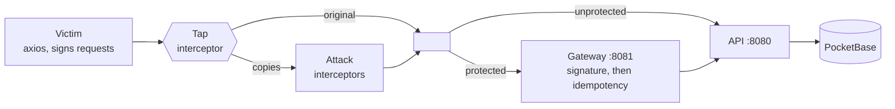

# orderguard

**English** · [Português](README.pt-BR.md)

One click should mean one order, even with a man in the middle.

This project reproduces a man-in-the-middle attack that duplicates, replays and tampers with order requests, then stops it with a Go gateway. The attacker is written as axios interceptors, and the demo counts the orders that really reached the database:

| | orders created from 1 click |
|---|---|
| Direct to the API | **14**, one of them with quantity × 100 |
| Through the gateway | **1** |

> **Status:** the API, gateway, attacker and Next.js app work today. Running several API replicas and the load test are still to come, so expect this page to change.

## Quick start

You need [Go](https://go.dev/dl/) 1.24+ and [Node.js](https://nodejs.org/) 20+. The same commands work in Git Bash, PowerShell, cmd and sh.

```sh
git clone https://github.com/raulbattistini3-sys/order-api-with-mim-fixed.git
cd order-api-with-mim-fixed
node scripts/run.mjs
```

That one command starts everything, runs the attacks, prints the results and stops. It exits with `0` only if the gateway let exactly one order through. The first run needs internet access: it downloads the PocketBase version pinned in `pocketbase/Dockerfile` into `bin/` and installs the attacker's dependencies.

| Command | What it does |
|---|---|
| `node scripts/run.mjs` | Runs the full demo once |
| `node scripts/run.mjs --serve` | Keeps the services up until Ctrl+C |
| `go test ./...` | Runs the Go tests |
| `go test -tags e2e ./internal/e2e/` | Runs the gateway and API against a real PocketBase. Needs `bin/pocketbase`, which `scripts/run.mjs` fetches |
| `npm test` (in `attacker/` or `web/`) | Runs the JS tests |

Service logs go to `bin/logs/`.

### Configuration

The API and gateway read `config.toml` (or the file named by `CONFIG_FILE`); `config.toml.example` documents every setting, and an unknown key stops them at startup. Values come from the built-in defaults, then the file, then the environment, so `MAX_IMPORT_MB=128` overrides `limits.max_import_mb`. Each setting's variable is its old name: `PORT`, `UPSTREAM`, `PB_URL`, `GATEWAY_RATE`, `GATEWAY_BURST`, `TRUST_PROXY`, `SIGNATURE_MAX_AGE`, `IMPORT_WORKERS`, `CNPJ_API_URL`, `MAX_BODY_MB`, `MAX_IMPORT_MB`.

Secrets are read from the environment only: `CLIENT_SECRET`, `PB_EMAIL` and `PB_PASSWORD`. `limits.max_body_mb` applies to every route and `limits.max_import_mb` to `POST /me/orders/import`; set `MAX_IMPORT_MB` in `web/.env.local` too, since the Next.js app can't read `config.toml`.

### Frontend

With the services up (`--serve`), in a second terminal:

```sh
cd web
cp .env.example .env.local
npm install
npm run dev
```

Open http://localhost:3000 and create an account. With no SMTP server configured, password reset links are printed to `bin/logs/pocketbase.log`. CNPJ data comes from [BrasilAPI](https://brasilapi.com.br/), so the CNPJs you type are sent to it; set `CNPJ_API_URL` on the API to use another source.

<details>
<summary>Run with Docker instead</summary>

```sh
docker compose up --build
cd attacker && npm install
npm run demo
```

</details>

## How it works



An axios request interceptor runs after the client decides what to send and before the request hits the wire, which is exactly where a man in the middle sits. A tap on the victim's client copies each signed request, and each attack is one interceptor applied to those copies. The attacker never has the signing secret.

| Attack | What the interceptor does | Direct to the API | Through the gateway |
|---|---|---|---|
| duplicate-race | Nothing; sends 10 copies at once | 10 new orders | No new order: `409` or a cached `201` |
| key-swap | Sets a fresh `Idempotency-Key` | New order | `401` signature mismatch |
| body-tamper | Multiplies `quantity` by 100 | Order for 100 | `401` signature mismatch |
| late-replay | Waits 6s, then sends | New order | `401` request expired |

A copy sometimes beats the victim's own request. That's harmless: it's the same signed request, so it creates the victim's order once. The victim gets `409`, retries with the same key, and receives the cached response.

## The fix, in three layers

A per-client rate limit guards the door; then every request needs a valid signature, and mutating routes an idempotency check, before it is forwarded.

**1. Rate limit** is the flood defence. Each client IP gets a token bucket of `GATEWAY_RATE` requests per second (default 100) with room for a `GATEWAY_BURST` spike (default 200). A client over its rate is turned away with `429` and a `Retry-After` before it reaches the API or the database, so one source can't overwhelm the system. Behind a proxy you control, set `TRUST_PROXY=1` to read the client IP from `X-Forwarded-For`.

**2. Signing** catches requests that were rewritten. Idempotency alone can't stop an attacker who simply invents a new key, so the client signs this string with HMAC-SHA256:

```
METHOD \n REQUEST-URI \n TIMESTAMP_MS \n IDEMPOTENCY-KEY \n hex(sha256(body))
```

- **Changed key, body or path:** the signature no longer matches.
- **Exact replay inside the time window:** absorbed by idempotency.
- **Exact replay after the window** (`SIGNATURE_MAX_AGE`, 30s by default): rejected as stale.

**3. Idempotency** catches duplicates, even across gateway replicas.

- The lock is a unique index on `idempotency_keys.key` in PocketBase. Concurrent requests race to insert a `pending` row, and exactly one wins.
- Reusing a key with a different request returns `422`.
- A key still in flight returns `409` with `Retry-After`. Once the original finishes, its stored response is replayed.
- A `5xx` frees the key so the client can retry. A `pending` row older than 30s counts as abandoned and can be taken over.
- As a last line of defence, `orders.idempotency_key` has its own unique index.

## Sessions

```
browser ──httpOnly cookie──▶ Next.js server ──JWT + HMAC signature──▶ gateway ──▶ API ──▶ PocketBase
```

- **The token lives in an `httpOnly`, `Secure`, `SameSite=Lax` cookie set by the Next.js server.** Page scripts can't read it, so an XSS bug can't steal it, unlike `localStorage`. The browser never talks to the gateway, and never sees the signing secret.
- **Session tokens never go in a URL.** URLs end up in history, logs and `Referer` headers. A password reset link is the one exception: its token is short-lived and single-use, and pages send `Referrer-Policy: no-referrer`.
- **The gateway checks every session with PocketBase**, so a password reset ends older sessions at once. It passes the result to the API as `X-User-Id` and `X-Company-Id`, and overwrites any value a client sent.
- **A customer can't order in someone else's name.** `/me/orders` takes the customer from the session and rejects one in the body.
- **Idempotency keys are scoped per user**, so one user's key can't return another user's cached order.
- **`/auth/*` skips idempotency on purpose.** That layer stores response bodies, and these contain session tokens.

## Spreadsheet import

`POST /me/orders/import` takes a `.csv` or `.xlsx` and creates one order per row, written in PocketBase batches (`api.import_batch_size`) by a pool of workers sharing a channel (`api.import_workers`). PocketBase takes one writer at a time, so one worker is the fastest setting, and a batch that fails, such as on a re-import, retries its rows one by one. It reads two layouts: the simple `item, quantity` columns, and the ERP `produtos` export (`name` + `quantidade_em_estoque`, semicolon-delimited, pt-BR decimals, extra columns ignored). Each row gets a deterministic idempotency key, so re-importing the same file writes each order once — the guarantee the gateway gives one request, applied to a whole file. Rows that don't parse are reported, not dropped. Up to 500k rows per file, and 96 MiB by default (`limits.max_import_mb`).

Files of up to `api.import_sync_rows` rows (default 15,000) finish while you wait. Larger ones answer `202` with a job at once, and `GET /me/orders/import/{id}` reports its progress. Jobs run one at a time, oldest first. They are stored in PocketBase and the file in `api.import_spool_dir`, so a restart resumes the unfinished job from its first row, and the per-row keys stop it writing any order twice. The queue expects a single API replica.

In the app, the orders page has an **Importar planilha** card with a downloadable template.

## Load test

`node loadtest/run.mjs` stands up an isolated stack and drives it with two generators that sign requests exactly as the client does — one in Go (`cmd/loadgen`), one in Rust (`loadtest/rust`). It fires N logical orders × M duplicates and reports throughput, latency and the status mix against:

- the **API directly** — every request lands (≈ N×M orders);
- an **open gateway** — idempotency collapses the duplicates to exactly N;
- a **rate-limited gateway** — the flood is shed with 429s and the gateway stays up;
- the **open gateway from Go and Rust at once** — two clients, one host, each still exactly N.

```sh
node loadtest/run.mjs --orders 400 --dupes 5 --concurrency 120 --rate 150 --burst 150
```

The generators are benchmarks for your own services, not attack tools: they load only a target you run. Needs Go, a Rust toolchain (the first run builds the Rust binary) and a PocketBase binary (`node scripts/run.mjs` once downloads it).

## Limits

- **This protects integrity, not confidentiality.** A man in the middle can still read the traffic, including customer names and order details. Production systems still need TLS.
- **The gateway must be the only way in.** The API's port is public here only so the demo can show what happens without protection.
- **The default secret and credentials are for local use only.** Replace them before deploying anything.
- **The rate limit is per IP, not per account.** It blunts a flood from one source, but a distributed flood, or slow password-guessing spread across many IPs, still gets through. Add a per-account login throttle, and in production a limiter at the edge as well.
- **Each CNPJ has one account.** There are no invitations yet, and a second person from the same company gets a `409`. Nothing proves the person registering works at that company, and email addresses aren't verified.
- **Sessions last 8 hours and aren't refreshed.** Users are logged out when the token expires.

## API

Served by the gateway on `:8081`. The API on `:8080` has the same routes with no checks, plus `GET /orders?customer=X` for the demo's count.

| Route | Details |
|---|---|
| `POST /orders` | Needs `Idempotency-Key` (8–255 chars of `[A-Za-z0-9_.:-]`), `X-Timestamp` (unix ms) and `X-Signature`. Body: `{"customer","item","quantity"}` |
| `POST /auth/register`, `/auth/login` | Return `{token, user}`. Registering also creates the company from its CNPJ. `phone` must be E.164, such as `+5511987654321` |
| `POST /auth/forgot-password`, `/auth/reset-password` | Password reset. The first always returns `204`, so it can't reveal which emails exist |
| `GET /auth/cnpj/{cnpj}` | Looks up a company. Accepts numeric and alphanumeric CNPJs |
| `GET /me` | The session's user and company |
| `GET`, `POST /me/orders` | The session's orders. `GET` takes `limit` (1–200, default 100) and `cursor`, and returns `{orders, next_cursor}`, newest first. `POST` also needs `Idempotency-Key`. Body: `{"item","quantity"}` |
| `GET /me/orders/summary` | `{orders, units, items, top_items}`, summed in the database |
| `GET`, `POST /me/todos`, `PATCH`, `DELETE /me/todos/{id}` | The session's to-dos |
| `GET /healthz` | Returns `204` |

Every route except `/healthz` needs `X-Timestamp` and `X-Signature`, and `/me` routes also need `Authorization: Bearer <token>`.

## Project layout

This follows the Go team's [server project layout](https://go.dev/doc/modules/layout#server-project). Each domain package defines a `Service` interface for its logic, the interfaces it needs from its stores, and `Routes`, whose handlers are functions closing over the service. Everything is passed in as a dependency and assembled in `internal/api` and each `main`, so a test can swap any layer, and only `internal/pocketbase` knows about the database.

```
cmd/api               order API: wiring only
cmd/gateway           protective gateway: wiring only
internal/api          assembles the API's routes from its services
internal/e2e          the whole stack against a real PocketBase
configs               config.toml and environment loading
internal/auth         accounts, sessions, HTTP handlers
internal/company      Company, CNPJ validation, registry lookup
internal/order        Order, Service, Repository, HTTP handlers
internal/todo         per-user to-dos
internal/gateway      rate limit → signature → idempotency → proxy
internal/signing      HMAC verification and middleware
internal/idempotency  Store interface and middleware
internal/ratelimit    per-client token bucket (flood defence)
internal/orderimport  spreadsheet parse and bounded worker pool
internal/pocketbase   REST client and every repository
internal/server       run loop, request logging, env
internal/httpjson     JSON response helpers
pocketbase/           Dockerfile, migrations and the dev mail hook
attacker/             victim client, attacks and demo (documented with JSDoc)
web/                  Next.js app: auth pages, orders and to-dos
cmd/loadgen           Go load generator
loadtest/             load test runner and Rust generator
scripts/run.mjs       runs everything without Docker
```

## Roadmap

- [x] Order API on PocketBase
- [x] Protective gateway with signing and idempotency
- [x] Attacker written as axios interceptors
- [x] Next.js app with accounts, orders and to-dos. Signing happens on its server, so the secret never reaches the browser.
- [x] Spreadsheet import (CSV/XLSX, including the products export) with a bounded worker pool
- [x] Per-IP rate limiting in the gateway
- [x] Load test: Go and Rust generators against the API and the gateway
- [ ] Several API replicas, grouping duplicate in-flight requests in Go (singleflight)
