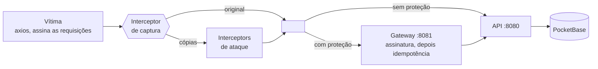

# orderguard

[English](README.md) · **Português**

Um clique deve gerar um pedido, mesmo com um man in the middle no caminho.

Este projeto reproduz um ataque man-in-the-middle que duplica, reenvia e adultera requisições de pedidos, e depois o bloqueia com um gateway em Go. O atacante é escrito com interceptors do axios, e a demo conta os pedidos que realmente chegaram ao banco:

| | pedidos criados com 1 clique |
|---|---|
| Direto na API | **14**, um deles com quantidade × 100 |
| Pelo gateway | **1** |

> **Status:** a API, o gateway, o atacante e o app em Next.js já funcionam. Rodar várias réplicas da API e o teste de carga ainda vão ser feitos, então esta página vai mudar.

## Como rodar

Você precisa do [Go](https://go.dev/dl/) 1.24+ e do [Node.js](https://nodejs.org/) 20+. Os mesmos comandos funcionam no Git Bash, PowerShell, cmd e sh.

```sh
git clone https://github.com/raulbattistini3-sys/order-api-with-mim-fixed.git
cd order-api-with-mim-fixed
node scripts/run.mjs
```

Esse único comando sobe tudo, executa os ataques, mostra os resultados e encerra. Ele só termina com código `0` se o gateway deixar passar exatamente um pedido. A primeira execução precisa de internet: ela baixa para `bin/` a versão do PocketBase fixada em `pocketbase/Dockerfile` e instala as dependências do atacante.

| Comando | O que faz |
|---|---|
| `node scripts/run.mjs` | Executa a demo completa uma vez |
| `node scripts/run.mjs --serve` | Mantém os serviços no ar até o Ctrl+C |
| `go test ./...` | Executa os testes em Go |
| `npm test` (em `attacker/` ou `web/`) | Executa os testes em JS |

Os logs dos serviços ficam em `bin/logs/`.

### Configuração

A API e o gateway leem o `config.toml` (ou o arquivo indicado em `CONFIG_FILE`), e uma chave desconhecida impede a inicialização. Os valores vêm dos padrões internos, depois do arquivo e depois do ambiente, então `MAX_IMPORT_MB=128` sobrescreve `limits.max_import_mb`. A variável de cada ajuste mantém o nome antigo: `PORT`, `UPSTREAM`, `PB_URL`, `GATEWAY_RATE`, `GATEWAY_BURST`, `TRUST_PROXY`, `SIGNATURE_MAX_AGE`, `IMPORT_WORKERS`, `CNPJ_API_URL`, `MAX_BODY_MB`, `MAX_IMPORT_MB`.

Os segredos são lidos só do ambiente: `CLIENT_SECRET`, `PB_EMAIL` e `PB_PASSWORD`. `limits.max_body_mb` vale para todas as rotas e `limits.max_import_mb` para `POST /me/orders/import`; defina `MAX_IMPORT_MB` também em `web/.env.local`, porque o app Next.js não lê o `config.toml`.

### Frontend

Com os serviços no ar (`--serve`), em outro terminal:

```sh
cd web
cp .env.example .env.local
npm install
npm run dev
```

Abra http://localhost:3000 e crie uma conta. Sem um servidor SMTP configurado, os links de redefinição de senha aparecem em `bin/logs/pocketbase.log`. Os dados de CNPJ vêm da [BrasilAPI](https://brasilapi.com.br/), então os CNPJs digitados são enviados a ela; defina `CNPJ_API_URL` na API para usar outra fonte.

<details>
<summary>Rodar com Docker</summary>

```sh
docker compose up --build
cd attacker && npm install
npm run demo
```

</details>

## Como funciona



Um interceptor de requisição do axios roda depois que o cliente decide o que enviar e antes de a requisição sair para a rede, que é exatamente onde um man in the middle fica. Um interceptor de captura no cliente da vítima copia cada requisição assinada, e cada ataque é um interceptor aplicado a essas cópias. O atacante nunca tem o segredo de assinatura.

| Ataque | O que o interceptor faz | Direto na API | Pelo gateway |
|---|---|---|---|
| duplicate-race | Nada; envia 10 cópias ao mesmo tempo | 10 pedidos novos | Nenhum pedido novo: `409` ou `201` em cache |
| key-swap | Define um novo `Idempotency-Key` | Pedido novo | `401` assinatura inválida |
| body-tamper | Multiplica `quantity` por 100 | Pedido de 100 unidades | `401` assinatura inválida |
| late-replay | Espera 6s e então envia | Pedido novo | `401` requisição expirada |

Às vezes uma cópia chega antes da requisição da própria vítima. Isso não causa problema: é a mesma requisição assinada, então cria o pedido da vítima uma única vez. A vítima recebe `409`, tenta de novo com a mesma chave e recebe a resposta em cache.

## A solução, em três camadas

Um limite de taxa por cliente protege a porta; depois toda requisição precisa de uma assinatura válida, e as rotas de escrita de uma verificação de idempotência, antes de ser encaminhada.

**1. Limite de taxa** é a defesa contra enxurradas. Cada IP de cliente recebe um balde de fichas de `GATEWAY_RATE` requisições por segundo (padrão 100), com folga para um pico de `GATEWAY_BURST` (padrão 200). Um cliente acima do seu limite é recusado com `429` e um `Retry-After` antes de chegar à API ou ao banco, então uma única origem não derruba o sistema. Atrás de um proxy que você controla, defina `TRUST_PROXY=1` para ler o IP de `X-Forwarded-For`.

**2. Assinatura** detecta requisições reescritas. Só a idempotência não impede um atacante que simplesmente inventa uma chave nova, então o cliente assina esta string com HMAC-SHA256:

```
METHOD \n REQUEST-URI \n TIMESTAMP_MS \n IDEMPOTENCY-KEY \n hex(sha256(body))
```

- **Chave, corpo ou caminho alterados:** a assinatura deixa de bater.
- **Reenvio idêntico dentro da janela de tempo:** absorvido pela idempotência.
- **Reenvio idêntico depois da janela** (`SIGNATURE_MAX_AGE`, 30s por padrão): rejeitado como expirado.

**3. Idempotência** detecta duplicatas, mesmo entre réplicas do gateway.

- A trava é um índice único em `idempotency_keys.key` no PocketBase. Requisições simultâneas disputam a inserção de uma linha `pending`, e exatamente uma vence.
- Reutilizar uma chave com uma requisição diferente retorna `422`.
- Uma chave ainda em processamento retorna `409` com `Retry-After`. Quando a original termina, a resposta armazenada é devolvida.
- Um `5xx` libera a chave para o cliente tentar de novo. Uma linha `pending` com mais de 30s é considerada abandonada e pode ser assumida.
- Como última linha de defesa, `orders.idempotency_key` tem o próprio índice único.

## Sessões

```
navegador ──cookie httpOnly──▶ servidor Next.js ──JWT + assinatura HMAC──▶ gateway ──▶ API ──▶ PocketBase
```

- **O token fica em um cookie `httpOnly`, `Secure` e `SameSite=Lax` definido pelo servidor Next.js.** Scripts da página não conseguem lê-lo, então uma falha de XSS não consegue roubá-lo, ao contrário do `localStorage`. O navegador nunca fala com o gateway e nunca vê o segredo de assinatura.
- **Tokens de sessão nunca vão na URL.** URLs acabam no histórico, em logs e no cabeçalho `Referer`. O link de redefinição de senha é a única exceção: o token dele tem vida curta e uso único, e as páginas enviam `Referrer-Policy: no-referrer`.
- **O gateway confere cada sessão com o PocketBase**, então redefinir a senha encerra as sessões antigas na hora. Ele repassa o resultado à API em `X-User-Id` e `X-Company-Id`, sobrescrevendo qualquer valor enviado pelo cliente.
- **Ninguém faz pedido em nome de outra pessoa.** `/me/orders` pega o cliente da sessão e rejeita esse campo no corpo.
- **As chaves de idempotência são separadas por usuário**, então a chave de um usuário não devolve o pedido em cache de outro.
- **`/auth/*` não passa pela idempotência, de propósito.** Essa camada guarda o corpo das respostas, e estas contêm tokens de sessão.

## Importação de planilhas

`POST /me/orders/import` recebe um `.csv` ou `.xlsx` e cria um pedido por linha, processado por um pool limitado de workers (`IMPORT_WORKERS`). Ele lê dois formatos: as colunas simples `item, quantity` e o export `produtos` do ERP (`name` + `quantidade_em_estoque`, separado por ponto e vírgula, decimais em pt-BR, colunas extras ignoradas). Cada linha recebe uma chave de idempotência determinística, então reenviar a mesma planilha grava cada pedido uma vez — a garantia que o gateway dá a uma requisição, aplicada a um arquivo inteiro. Linhas que não são lidas são reportadas, não descartadas. Até 500 mil linhas por arquivo e 96 MiB por padrão (`limits.max_import_mb`).

Arquivos de até `api.import_sync_rows` linhas (padrão 15.000) terminam enquanto você espera. Os maiores respondem `202` com um job na hora, e `GET /me/orders/import/{id}` informa o progresso. Os jobs rodam um por vez, do mais antigo para o mais novo. Eles ficam no PocketBase e o arquivo em `api.import_spool_dir`, então um reinício retoma o job inacabado desde a primeira linha, e as chaves por linha impedem que um pedido seja gravado duas vezes. A fila pressupõe uma única réplica da API.

No app, a página de pedidos tem um cartão **Importar planilha** com um modelo para baixar.

## Teste de carga

`node loadtest/run.mjs` sobe um stack isolado e o pressiona com dois geradores que assinam as requisições exatamente como o cliente — um em Go (`cmd/loadgen`), outro em Rust (`loadtest/rust`). Ele dispara N pedidos lógicos × M duplicatas e reporta vazão, latência e a distribuição de status contra:

- a **API diretamente** — toda requisição vira pedido (≈ N×M);
- um **gateway aberto** — a idempotência colapsa as duplicatas em exatamente N;
- um **gateway com limite de taxa** — a enxurrada é descartada com 429 e o gateway continua de pé;
- o **gateway aberto com Go e Rust ao mesmo tempo** — dois clientes, um host, cada um ainda exatamente N.

```sh
node loadtest/run.mjs --orders 400 --dupes 5 --concurrency 120 --rate 150 --burst 150
```

Os geradores são benchmarks dos seus próprios serviços, não ferramentas de ataque: só pressionam um alvo que você mesmo roda. Precisa de Go, de um toolchain Rust (a primeira execução compila o binário Rust) e de um binário do PocketBase (`node scripts/run.mjs` uma vez o baixa).

## Limitações

- **Isto protege a integridade, não a confidencialidade.** Um man in the middle ainda consegue ler o tráfego, incluindo nomes de clientes e detalhes dos pedidos. Sistemas em produção continuam precisando de TLS.
- **O gateway precisa ser a única entrada.** A porta da API só é pública aqui para a demo mostrar o que acontece sem proteção.
- **O segredo e as credenciais padrão são só para uso local.** Troque-os antes de publicar qualquer coisa.
- **O limite de taxa é por IP, não por conta.** Ele contém uma enxurrada de uma origem, mas um ataque distribuído, ou tentativas lentas de adivinhar senha espalhadas por vários IPs, ainda passam. Adicione um limite de login por conta e, em produção, um limitador também na borda.
- **Cada CNPJ tem uma conta.** Ainda não há convites, e uma segunda pessoa da mesma empresa recebe `409`. Nada comprova que quem se cadastra trabalha na empresa, e os e-mails não são verificados.
- **As sessões duram 8 horas e não são renovadas.** O usuário é deslogado quando o token expira.

## API

Servida pelo gateway em `:8081`. A API em `:8080` tem as mesmas rotas, sem nenhuma verificação, além de `GET /orders?customer=X` para a contagem da demo.

| Rota | Detalhes |
|---|---|
| `POST /orders` | Exige `Idempotency-Key` (8 a 255 caracteres de `[A-Za-z0-9_.:-]`), `X-Timestamp` (unix em ms) e `X-Signature`. Corpo: `{"customer","item","quantity"}` |
| `POST /auth/register`, `/auth/login` | Retornam `{token, user}`. O cadastro também cria a empresa a partir do CNPJ. `phone` precisa estar em E.164, como `+5511987654321` |
| `POST /auth/forgot-password`, `/auth/reset-password` | Redefinição de senha. A primeira sempre retorna `204`, para não revelar quais e-mails existem |
| `GET /auth/cnpj/{cnpj}` | Consulta uma empresa. Aceita CNPJ numérico e alfanumérico |
| `GET /me` | O usuário e a empresa da sessão |
| `GET`, `POST /me/orders` | Os pedidos da sessão. `GET` aceita `limit` (1–200, padrão 100) e `cursor`, e retorna `{orders, next_cursor}`, do mais novo para o mais antigo. `POST` também exige `Idempotency-Key`. Corpo: `{"item","quantity"}` |
| `GET /me/orders/summary` | `{orders, units, items, top_items}`, somados no banco |
| `GET`, `POST /me/todos`, `PATCH`, `DELETE /me/todos/{id}` | As tarefas da sessão |
| `GET /healthz` | Retorna `204` |

Toda rota exceto `/healthz` exige `X-Timestamp` e `X-Signature`, e as rotas `/me` também exigem `Authorization: Bearer <token>`.

## Estrutura do projeto

Segue o [layout de projetos de servidor](https://go.dev/doc/modules/layout#server-project) do time do Go e usa apenas a biblioteca padrão. As dependências são passadas por construtores e ligadas em cada `main`. Os pacotes de domínio definem as interfaces de que precisam, e só `internal/pocketbase` conhece o banco.

```
cmd/api               API de pedidos: só a ligação das dependências
cmd/gateway           gateway de proteção: só a ligação das dependências
configs               leitura do config.toml e do ambiente
internal/auth         contas, sessões, handlers HTTP
internal/company      Company, validação de CNPJ, consulta ao registro
internal/order        Order, Repository, handlers HTTP
internal/todo         tarefas por usuário
internal/gateway      limite de taxa → assinatura → idempotência → proxy
internal/signing      verificação HMAC e middleware
internal/idempotency  interface Store e middleware
internal/ratelimit    balde de fichas por cliente (defesa contra enxurrada)
internal/orderimport  leitura de planilha e pool limitado de workers
internal/pocketbase   cliente REST e todos os repositórios
internal/server       ciclo de execução, logs de requisição, env
internal/httpjson     helpers de resposta JSON
pocketbase/           Dockerfile, migrations e o hook de e-mail local
attacker/             cliente da vítima, ataques e demo (documentados com JSDoc)
web/                  app Next.js: páginas de acesso, pedidos e tarefas
cmd/loadgen           gerador de carga em Go
loadtest/             runner do teste de carga e gerador em Rust
scripts/run.mjs       roda tudo sem Docker
```

## Próximos passos

- [x] API de pedidos sobre o PocketBase
- [x] Gateway de proteção com assinatura e idempotência
- [x] Atacante escrito com interceptors do axios
- [x] App em Next.js com contas, pedidos e tarefas. A assinatura acontece no servidor dele, para o segredo nunca chegar ao navegador.
- [x] Importação de planilhas (CSV/XLSX, incluindo o export de produtos) com pool limitado de workers
- [x] Limite de taxa por IP no gateway
- [x] Teste de carga: geradores em Go e Rust contra a API e o gateway
- [ ] Várias réplicas da API, agrupando em Go as requisições duplicadas em andamento (singleflight)
