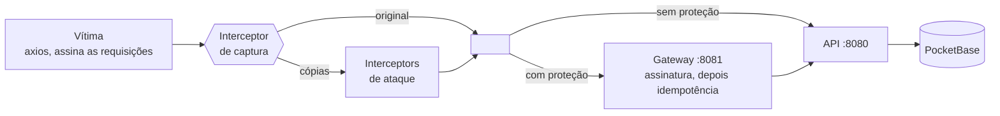

# orderguard

[English](README.md) · **Português**

Um clique deve gerar um pedido, mesmo com um man in the middle no caminho.

Este projeto reproduz um ataque man-in-the-middle que duplica, reenvia e adultera requisições de pedidos, e depois o bloqueia com um gateway em Go. O atacante é escrito com interceptors do axios, e a demo conta os pedidos que realmente chegaram ao banco:

| | pedidos criados com 1 clique |
|---|---|
| Direto na API | **14**, um deles com quantidade × 100 |
| Pelo gateway | **1** |

> **Status:** a API, o gateway e o atacante já funcionam. O frontend em Next.js e o teste de carga ainda vão ser feitos, então esta página vai mudar.

## Como rodar

Você precisa do [Go](https://go.dev/dl/) 1.24+ e do [Node.js](https://nodejs.org/) 20+. Os mesmos comandos funcionam no Git Bash, PowerShell, cmd e sh.

```sh
git clone https://github.com/raulbattistini3-sys/order-api-with-mim-fixed.git
cd order-api-with-mim-fixed
node scripts/run.mjs
```

Esse único comando sobe tudo, executa os ataques, mostra os resultados e encerra. Ele só termina com código `0` se o gateway deixar passar exatamente um pedido. A primeira execução precisa de internet: ela baixa para `bin/` a versão do PocketBase fixada em `pocketbase/Dockerfile` e instala as dependências do atacante.

| Comando | O que faz |
|---|---|
| `node scripts/run.mjs` | Executa a demo completa uma vez |
| `node scripts/run.mjs --serve` | Mantém os serviços no ar até o Ctrl+C |
| `go test ./...` | Executa os testes em Go |
| `npm test` (em `attacker/`) | Executa os testes em JS |

Os logs dos serviços ficam em `bin/logs/`.

<details>
<summary>Rodar com Docker</summary>

```sh
docker compose up --build
cd attacker && npm install
npm run demo
```

</details>

## Como funciona



Um interceptor de requisição do axios roda depois que o cliente decide o que enviar e antes de a requisição sair para a rede, que é exatamente onde um man in the middle fica. Um interceptor de captura no cliente da vítima copia cada requisição assinada, e cada ataque é um interceptor aplicado a essas cópias. O atacante nunca tem o segredo de assinatura.

| Ataque | O que o interceptor faz | Direto na API | Pelo gateway |
|---|---|---|---|
| duplicate-race | Nada; envia 10 cópias ao mesmo tempo | 10 pedidos novos | Nenhum pedido novo: `409` ou `201` em cache |
| key-swap | Define um novo `Idempotency-Key` | Pedido novo | `401` assinatura inválida |
| body-tamper | Multiplica `quantity` por 100 | Pedido de 100 unidades | `401` assinatura inválida |
| late-replay | Espera 6s e então envia | Pedido novo | `401` requisição expirada |

Às vezes uma cópia chega antes da requisição da própria vítima. Isso não causa problema: é a mesma requisição assinada, então cria o pedido da vítima uma única vez. A vítima recebe `409`, tenta de novo com a mesma chave e recebe a resposta em cache.

## A solução, em duas camadas

As duas camadas rodam no gateway, primeiro a assinatura.

**1. Assinatura** detecta requisições reescritas. Só a idempotência não impede um atacante que simplesmente inventa uma chave nova, então o cliente assina esta string com HMAC-SHA256:

```
METHOD \n REQUEST-URI \n TIMESTAMP_MS \n IDEMPOTENCY-KEY \n hex(sha256(body))
```

- **Chave, corpo ou caminho alterados:** a assinatura deixa de bater.
- **Reenvio idêntico dentro da janela de tempo:** absorvido pela idempotência.
- **Reenvio idêntico depois da janela** (`SIGNATURE_MAX_AGE`, 30s por padrão): rejeitado como expirado.

**2. Idempotência** detecta duplicatas, mesmo entre réplicas do gateway.

- A trava é um índice único em `idempotency_keys.key` no PocketBase. Requisições simultâneas disputam a inserção de uma linha `pending`, e exatamente uma vence.
- Reutilizar uma chave com uma requisição diferente retorna `422`.
- Uma chave ainda em processamento retorna `409` com `Retry-After`. Quando a original termina, a resposta armazenada é devolvida.
- Um `5xx` libera a chave para o cliente tentar de novo. Uma linha `pending` com mais de 30s é considerada abandonada e pode ser assumida.
- Como última linha de defesa, `orders.idempotency_key` tem o próprio índice único.

## Limitações

- **Isto protege a integridade, não a confidencialidade.** Um man in the middle ainda consegue ler o tráfego, incluindo nomes de clientes e detalhes dos pedidos. Sistemas em produção continuam precisando de TLS.
- **O gateway precisa ser a única entrada.** A porta da API só é pública aqui para a demo mostrar o que acontece sem proteção.
- **O segredo e as credenciais padrão são só para uso local.** Troque-os antes de publicar qualquer coisa.

## API

Servida pelo gateway em `:8081`. A API em `:8080` tem as mesmas rotas, sem nenhuma verificação.

| Rota | Detalhes |
|---|---|
| `POST /orders` | Exige `Idempotency-Key` (8 a 255 caracteres de `[A-Za-z0-9_.:-]`), `X-Timestamp` (unix em ms) e `X-Signature`. Corpo: `{"customer","item","quantity"}` |
| `GET /orders?customer=X` | Retorna `{count, orders}` com os 50 pedidos mais recentes |
| `GET /healthz` | Retorna `204` |

## Estrutura do projeto

Segue o [layout de projetos de servidor](https://go.dev/doc/modules/layout#server-project) do time do Go e usa apenas a biblioteca padrão. As dependências são passadas por construtores e ligadas em cada `main`. Os pacotes de domínio definem as interfaces de que precisam, e só `internal/pocketbase` conhece o banco.

```
cmd/api               API de pedidos: só a ligação das dependências
cmd/gateway           gateway de proteção: só a ligação das dependências
internal/order        Order, Repository, handlers HTTP
internal/gateway      assinatura → idempotência → proxy reverso
internal/signing      verificação HMAC e middleware
internal/idempotency  interface Store e middleware
internal/pocketbase   cliente REST e os dois repositórios
internal/server       ciclo de execução, logs de requisição, env
internal/httpjson     helpers de resposta JSON
pocketbase/           Dockerfile e migrations
attacker/             cliente da vítima, ataques e demo (documentados com JSDoc)
scripts/run.mjs       roda tudo sem Docker
```

## Próximos passos

- [x] API de pedidos sobre o PocketBase
- [x] Gateway de proteção com assinatura e idempotência
- [x] Atacante escrito com interceptors do axios
- [ ] Frontend em Next.js que envia pedidos reais. A assinatura acontece em uma Server Action ou route handler, para o segredo nunca chegar ao navegador.
- [ ] Teste de carga comparando a API e o gateway, cada um com várias duplicatas por clique
